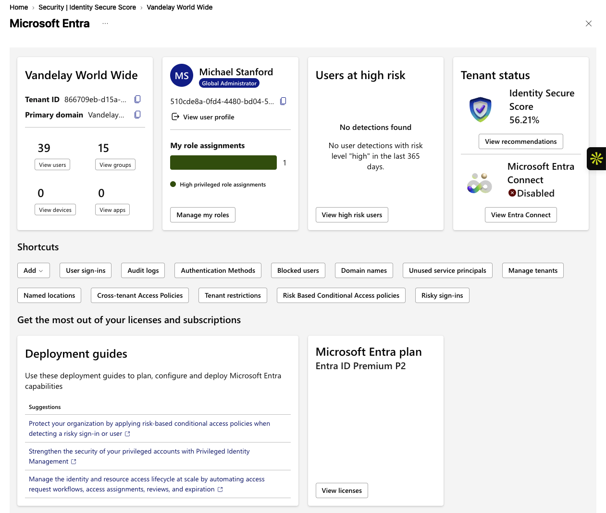
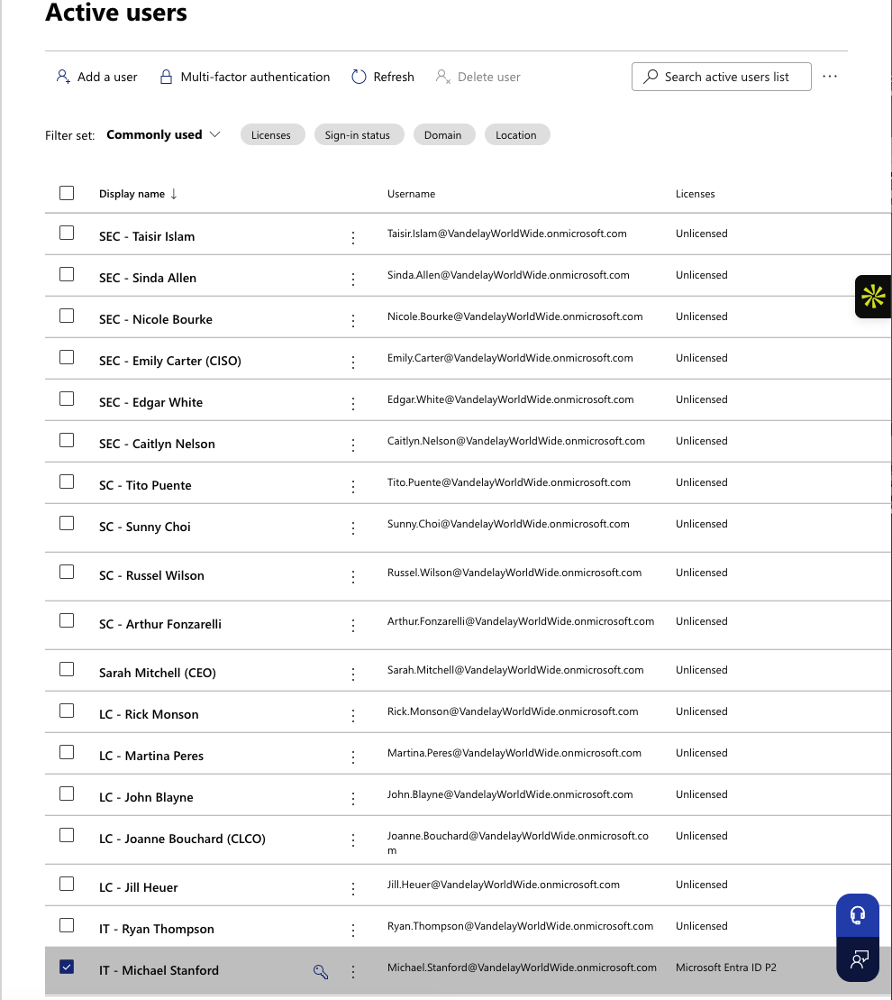
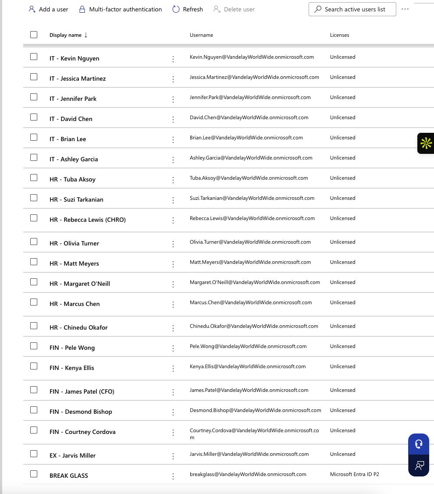
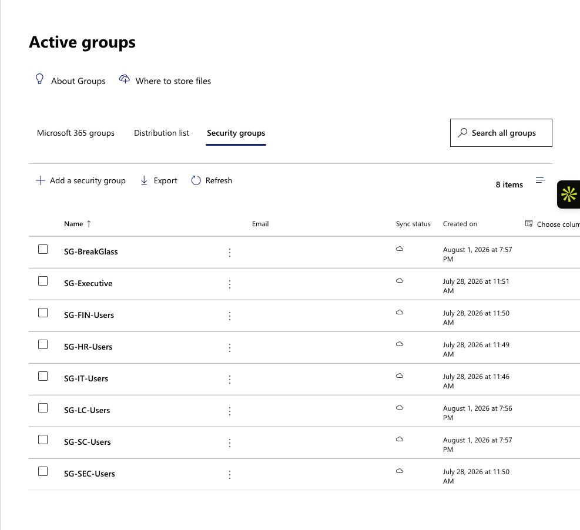
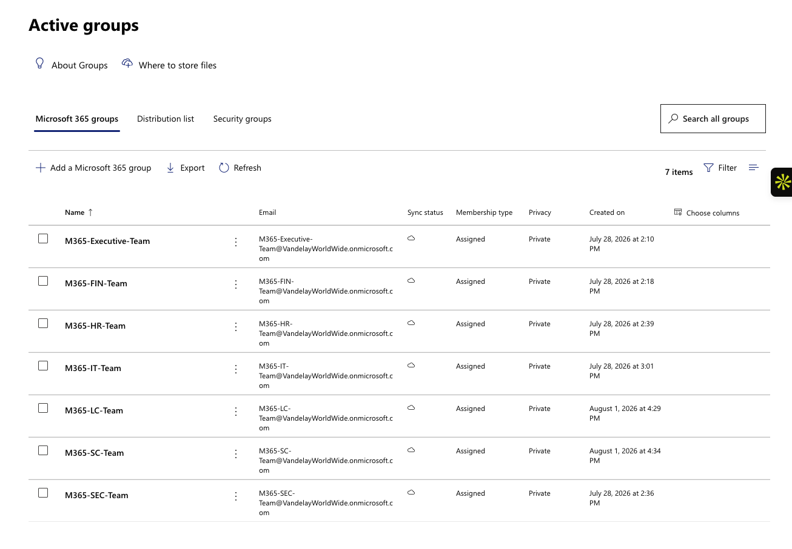
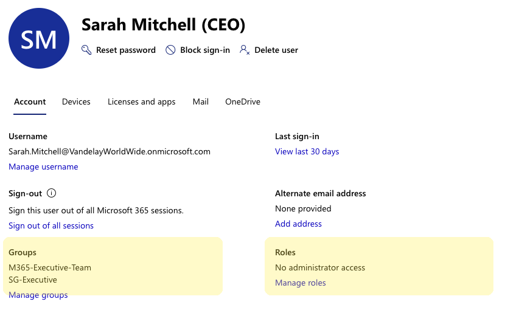
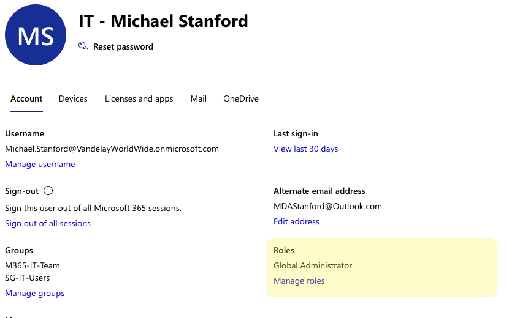
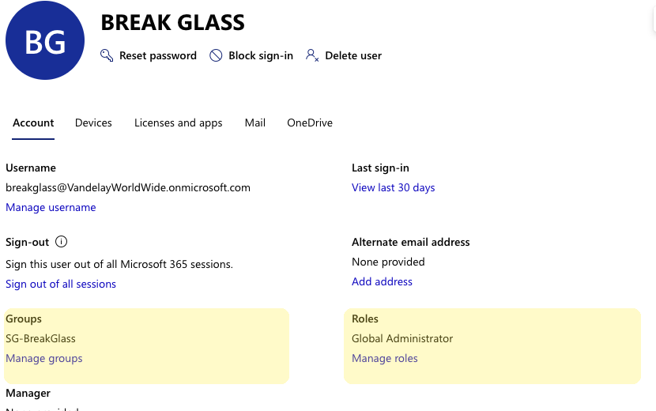
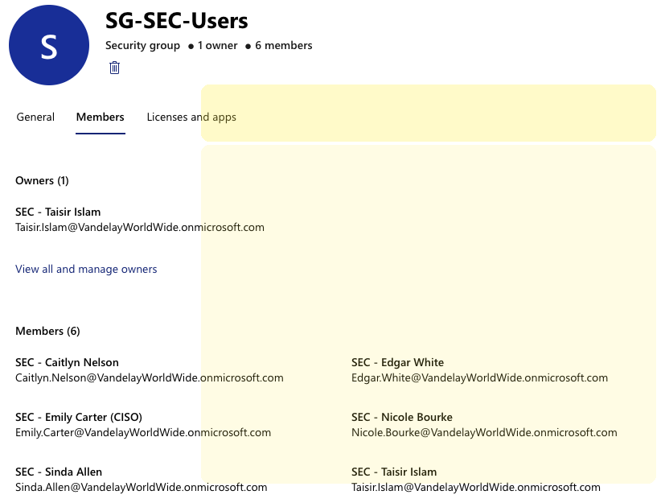

# Lab 01 — Building Vandelay Health's Identity Foundation

<mark>**FICTIONAL COMPANY — Vandelay Health is a fictional healthcare technology company that produces the Ninja Sleeper, a commercialized version of technology originally developed for the U.S. military to address sleep apnea in field environments.**</mark>

## Business Requirement

Vandelay Health needed a Microsoft Entra ID identity foundation to support workforce access, departmental organization, and future identity governance controls.

## Implementation

I established the Entra ID environment with 39 user identities and 15 groups, organizing access by department and separating security permissions from Microsoft 365 collaboration.

I configured employee accounts with organizational attributes, including department, job title, location, and manager.

I organized departmental access through security groups and maintained separate Microsoft 365 groups for collaboration.

I separated executive access from administrative privileges, configured a dedicated IAM administrator account, and established an emergency-access account.

I reviewed Information Security group membership and ownership as part of the configuration validation.

## Outcome

The lab established the initial identity and group structure for Vandelay Health, providing a foundation for Conditional Access, identity lifecycle management, privileged access, and access governance.

**Technical environment:** Microsoft Entra ID P2.
