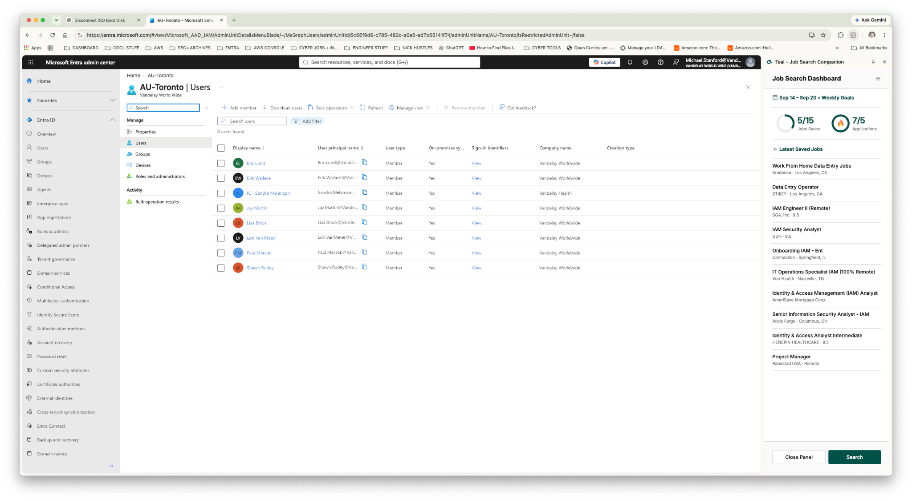
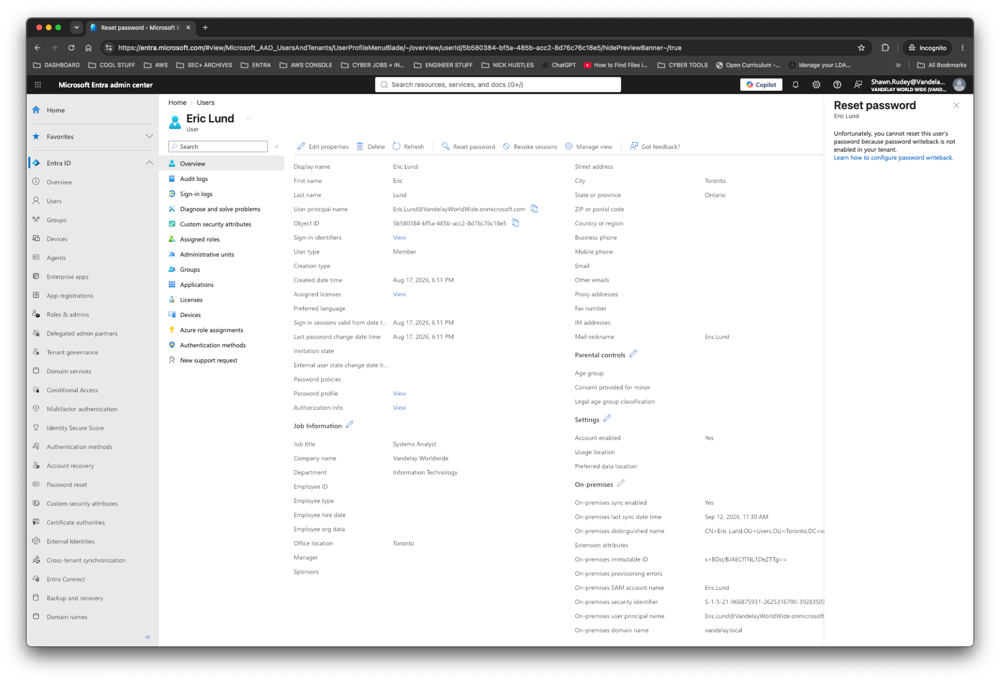
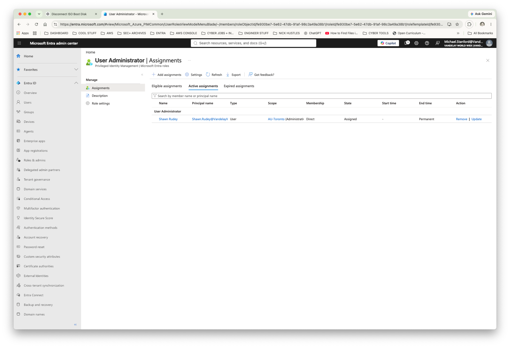
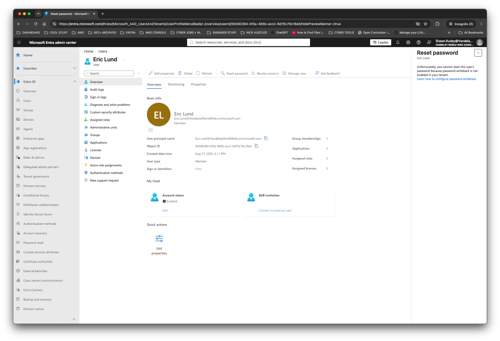
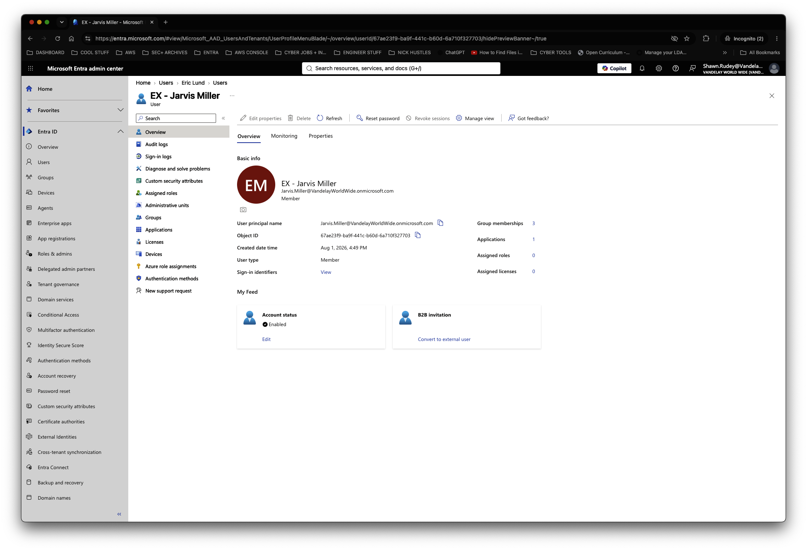

# Vandelay Health — Lab 16: Administrative Units & Delegated Administration

<mark>**FICTIONAL COMPANY — Vandelay Health is a fictional healthcare technology company that produces the Ninja Sleeper, a commercialized version of technology originally developed for the U.S. military to address sleep apnea in field environments.**</mark>

## Project Overview

As Vandelay Health expands its operations, protecting that proprietary technology requires more than controlling access to applications and data. Administrative privileges must also follow least-privilege principles. Administrators responsible for one location should not automatically receive authority over identities throughout the entire organization.

This lab addresses that requirement by implementing scoped administrative delegation in Microsoft Entra ID using an Administrative Unit.

---

## Business Scenario

Vandelay Health's Toronto Innovation Center has grown into a distinct operational location with its own identity administration requirements.

Routine identity-management tasks for Toronto should no longer require an administrator with tenant-wide authority. Vandelay therefore needs a method of delegating administration of Toronto identities without granting the local administrator equivalent authority over employees elsewhere in the organization.

The IAM team has selected **Shawn Rudey** to perform delegated user administration for Toronto.

The implementation must:

- Establish a dedicated administrative boundary for Toronto.
- Place the appropriate Toronto identities within that boundary.
- Delegate User Administrator privileges to Shawn Rudey.
- Scope Shawn's administrative authority to Toronto rather than the entire Entra tenant.
- Validate that Shawn can administer an identity inside the Toronto boundary.
- Validate that the same administrative capabilities are unavailable against an identity outside the Toronto boundary.

This creates a practical least-privilege model in which administrative authority follows organizational responsibility.

---

## Administrative Unit Design

A new Administrative Unit was created:

**AU-Toronto**

The Administrative Unit establishes a logical administrative boundary around identities associated with the Toronto operation.

The following eight identities were added to AU-Toronto:

- Eric Lund
- Erik Wallace
- IC - Sandra Melancon
- Jay Martin
- Lisa Brock
- Lori Van Meter
- Paul Merson
- Shawn Rudey

Administrative Units do not replace security groups or Microsoft 365 groups. Instead, they provide a mechanism for scoping administrative authority to a defined subset of directory objects.

This distinction allows Vandelay Health to maintain existing groups for application, collaboration, and resource access while independently controlling who is permitted to administer identities.

---

## Existing Privilege Review

During implementation, the IAM team reviewed existing User Administrator assignments.

The review identified multiple users holding User Administrator privileges. This represented broader administrative access than required for the Toronto delegation model.

The assignments were reviewed and unnecessary administrative privileges were removed.

Shawn Rudey was retained as the delegated administrator for Toronto.

This remediation reduced unnecessary privileged access and established a cleaner least-privilege administrative model.

---

## Delegated Role Assignment

Shawn Rudey was assigned the Microsoft Entra built-in:

**User Administrator**

The role was scoped specifically to:

**AU-Toronto**

The resulting authorization model was:

**Shawn Rudey → User Administrator → AU-Toronto**

This is significantly different from assigning User Administrator at the tenant level.

A tenant-wide assignment would allow administrative actions against users throughout Vandelay Health. The Administrative Unit assignment limits Shawn's delegated authority to identities contained within the Toronto administrative boundary.

---

## Validation Strategy

The implementation was tested using both positive and negative validation.

Rather than assuming the role assignment was working because it appeared in the Entra portal, the IAM team tested Shawn's effective administrative capabilities against two different identities.

### Positive Test — Toronto Identity

Shawn Rudey signed into Microsoft Entra and accessed:

**Eric Lund**

Eric is a member of AU-Toronto.

Administrative controls were available to Shawn, including user-management actions such as:

- Edit properties
- Delete
- Reset password
- Revoke sessions

This confirmed that Shawn received delegated administrative authority over an identity inside his assigned Administrative Unit.

The account was not deleted; the availability of the administrative control was used to validate authorization.

---

## Hybrid Password Management Observation

A password reset was also tested against Eric Lund.

Although Shawn had authorization to initiate the administrative action, Microsoft Entra returned the following condition:

**Password writeback is not enabled in the tenant.**

Eric is synchronized from the on-premises Active Directory environment through Microsoft Entra Connect.

The result demonstrates an important distinction between:

**Authorization to perform an administrative operation**

and

**The underlying hybrid identity infrastructure required to complete that operation.**

Shawn's Administrative Unit role permitted the operation, but the synchronized account remained dependent on the on-premises password authority because password writeback had not been configured.

This behavior was documented rather than treated as an IAM authorization failure.

---

## Negative Test — Out-of-Scope Identity

A second validation was performed against:

**EX - Jarvis Miller**

Jarvis was deliberately left outside AU-Toronto, making the account a negative-control identity.

While authenticated as Shawn Rudey, the IAM team opened Jarvis Miller's user profile.

Administrative actions including:

- Edit properties
- Delete
- Reset password
- Revoke sessions

were unavailable.

The controls appeared disabled in the Entra portal.

This demonstrated that Shawn's User Administrator role did not provide equivalent administrative authority over an identity outside AU-Toronto.

The comparison provided direct evidence that the Administrative Unit was functioning as an administrative scope boundary.

---

## Validation Result

The final authorization model successfully demonstrated:

**In-scope user**

Eric Lund  
↓  
Member of AU-Toronto  
↓  
Shawn's delegated User Administrator privileges apply  
↓  
Administrative controls available

**Out-of-scope user**

EX - Jarvis Miller  
↓  
Not a member of AU-Toronto  
↓  
Outside Shawn's delegated administrative scope  
↓  
Administrative controls unavailable

The positive and negative tests demonstrate that administrative authority can be delegated without granting unnecessary tenant-wide privileges.

---

## Security Principles Demonstrated

This lab demonstrates several practical IAM and identity-governance concepts:

### Least Privilege

Shawn receives only the administrative authority required for his assigned population rather than tenant-wide User Administrator access.

### Delegated Administration

Administrative responsibilities can be distributed to regional or departmental administrators without granting equivalent authority across the entire organization.

### Administrative Scope

Administrative Units provide a boundary for Microsoft Entra role assignments, separating the population an administrator manages from the broader directory.

### Privileged Access Review

Existing administrative assignments were reviewed and unnecessary User Administrator privileges were removed before the final delegated model was established.

### Positive and Negative Validation

The configuration was tested against both an in-scope and an out-of-scope identity rather than relying solely on configuration screens.

### Hybrid Identity Awareness

The password-reset test demonstrated that authorization and identity-source architecture are separate considerations. An administrator may have permission to initiate an action while hybrid configuration determines whether that action can be completed.

---

## Outcome

Vandelay Health successfully implemented location-scoped delegated administration for its Toronto operation.

Instead of granting Shawn Rudey tenant-wide User Administrator privileges, Microsoft Entra Administrative Units were used to restrict his authority to the Toronto identity population.

The implementation was validated from the delegated administrator's account using both an authorized Toronto identity and an unauthorized out-of-scope identity.

The lab demonstrates a complete IAM workflow:

**Business requirement → administrative boundary → membership assignment → privilege review → scoped role delegation → positive validation → negative validation**

The resulting design reduces unnecessary administrative privilege while allowing operational identity-management responsibilities to be delegated to the appropriate administrator.

---

---

## Technical reference

### Environment

The lab uses Vandelay Health's existing hybrid identity environment:

- Microsoft Entra ID
- Microsoft Entra administrative roles
- Microsoft Entra Administrative Units
- Windows Server Active Directory
- Microsoft Entra Connect
- Password Hash Synchronization
- Vandelay World Wide Entra tenant
- `vandelay.local` Active Directory domain

Toronto contains a combination of synchronized Active Directory identities and cloud-managed identities.

---

### Skills Demonstrated

- Microsoft Entra ID
- Administrative Units
- Microsoft Entra RBAC
- Delegated Administration
- User Administrator Role
- Least-Privilege Access
- Identity Governance
- Privileged Access Review
- Administrative Scope
- Hybrid Identity
- Active Directory
- Microsoft Entra Connect
- Password Hash Synchronization
- Password Writeback Concepts
- Positive and Negative Authorization Testing
- IAM Documentation and Validation
