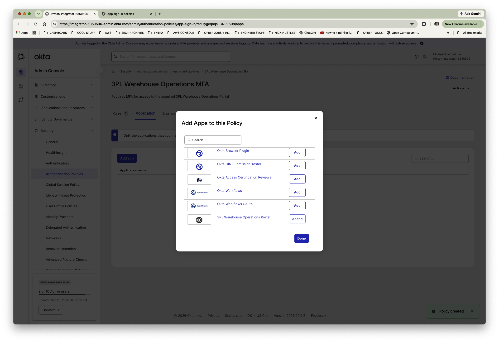
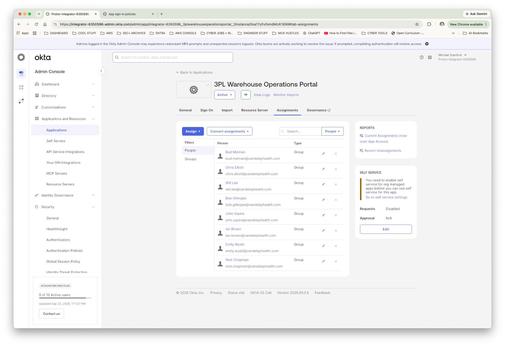
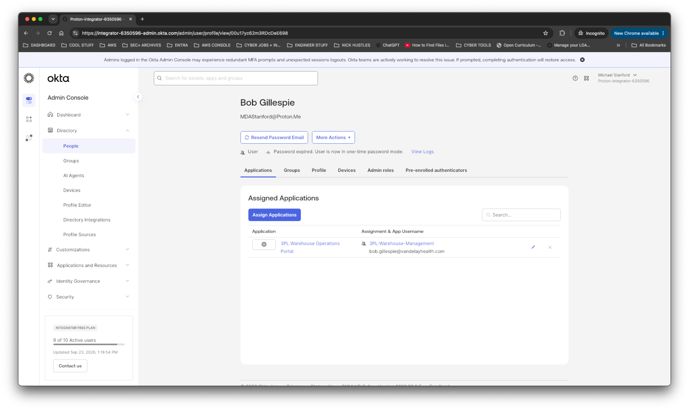
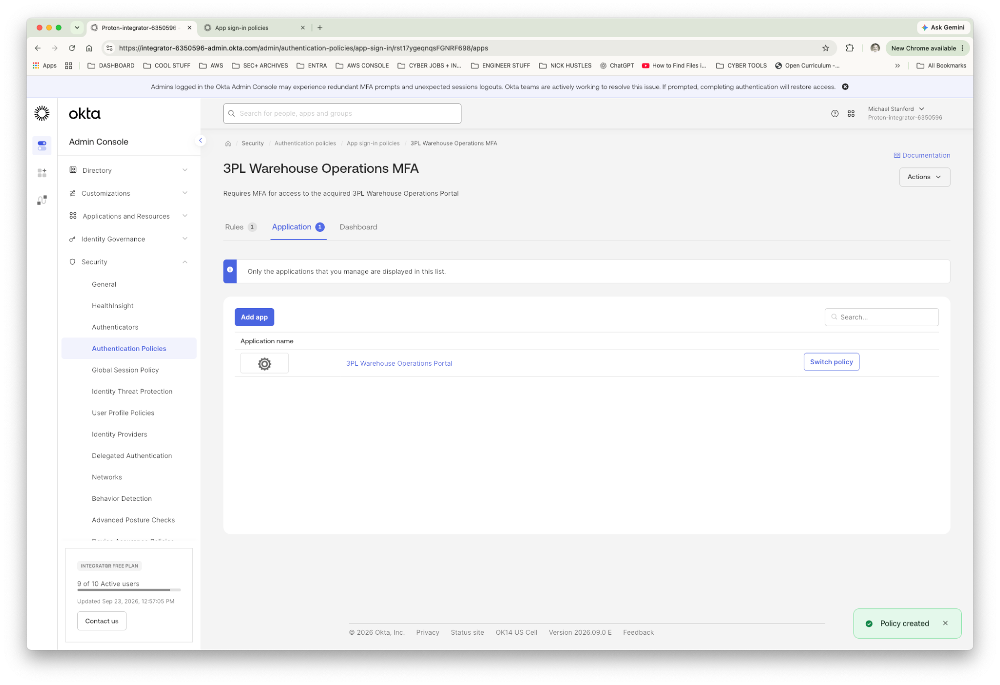
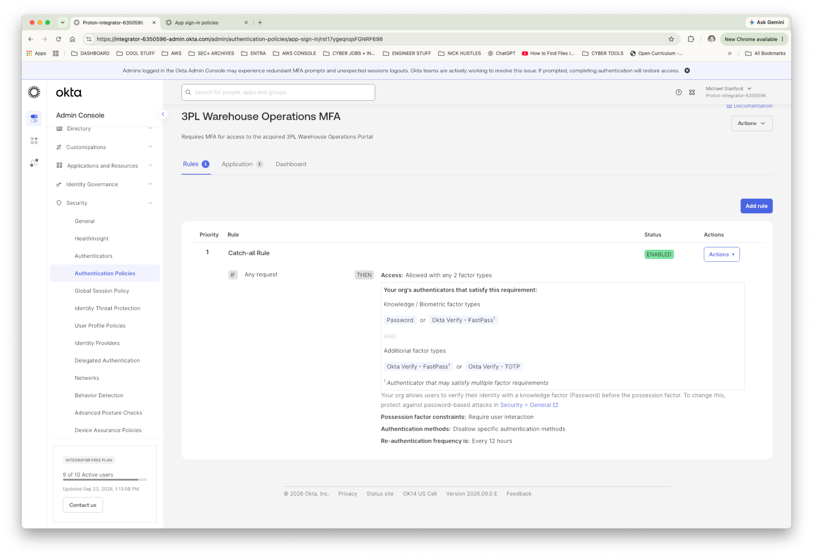
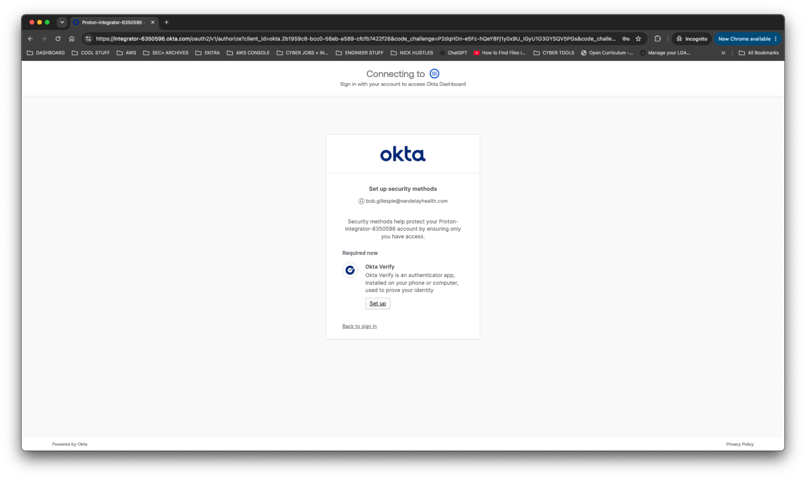
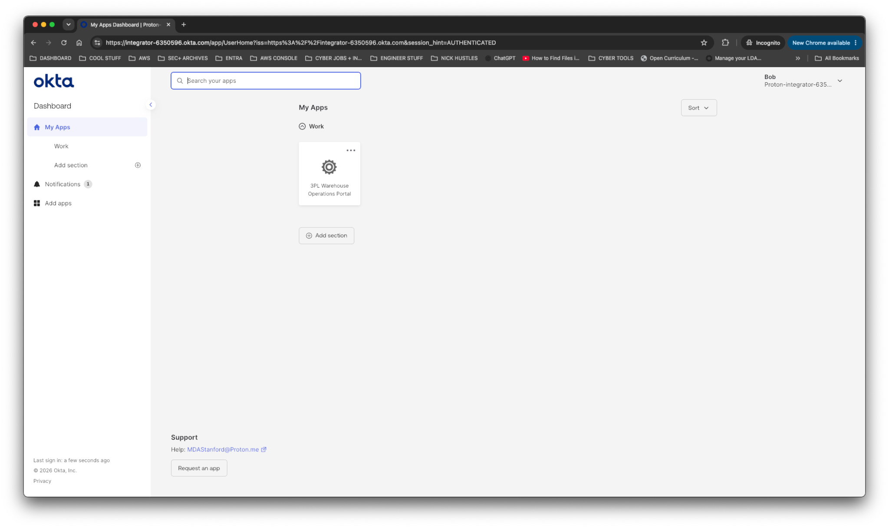
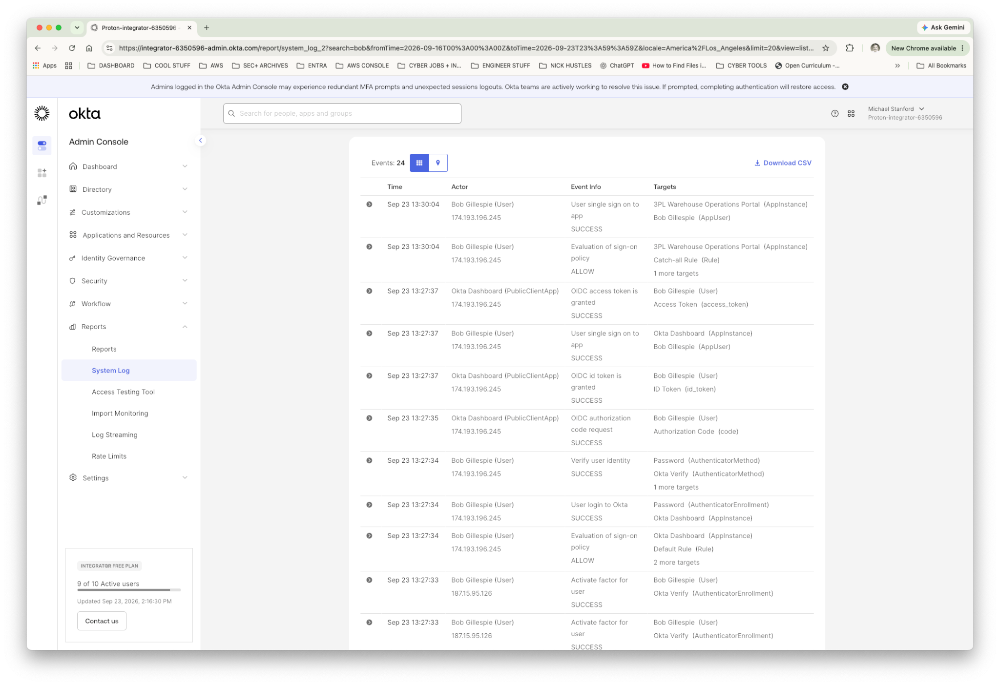

# Vandelay Health — Lab 18: Okta Workforce Identity — SSO, MFA & Group-Based Access

> **FICTIONAL COMPANY:** Vandelay Health is a fictional healthcare technology company that produces the Ninja Sleeper, a commercialized version of technology originally developed for the U.S. military to address sleep apnea in field environments.

## Project Overview

Vandelay Health is a fictional healthcare technology company whose flagship product, the Ninja Sleeper, originated from a federal government contract requiring a silent sleeping solution for military personnel operating in the field. Vandelay Health subsequently adapted the technology for commercial use while retaining as much of the original proprietary design and intellectual property as possible.

As Vandelay expands, it has acquired the third-party logistics provider (3PL) that supports warehouse operations. The acquired company already uses Okta Workforce Identity, while Vandelay's core identity environment uses Microsoft Entra ID and Active Directory.

Rather than disrupting warehouse operations with an immediate platform migration, I inherited the existing Okta environment as the basis for this lab and implemented workforce identity, application access, and authentication controls.

---

## Business Scenario

The acquired 3PL workforce requires continued access to a warehouse operations application while Vandelay establishes consistent identity and access controls.

The IAM implementation must:

- Create and organize the acquired 3PL workforce in Okta.
- Use business-role groups to manage application access.
- Configure a SAML 2.0 application integration for the warehouse portal.
- Require multi-factor authentication for application access.
- Validate first-time user onboarding and Okta Verify enrollment.
- Confirm that authorized users receive the application through group membership.
- Review Okta System Log events to validate authentication, policy evaluation, and application SSO activity.

---

## Environment

- Okta Workforce Identity
- Okta Integrator Free Plan
- Okta Universal Directory
- Okta Groups
- SAML 2.0
- Okta Authentication Policies
- Okta Verify
- Okta System Log

---

## 3PL Workforce

I created eight acquired 3PL identities in Okta:

| User | Business Role |
|---|---|
| Bob Gillespie | Warehouse Manager |
| Ian Brown | Assistant Manager 1 |
| John Squire | Assistant Manager 2 |
| Will Lee | Inventory Manager |
| Chris Elliott | Assistant Inventory Manager |
| Bud Melman | Shipping & Receiving Manager |
| Emily Wyatt | Foreperson |
| Nick Chapman | Assistant Foreperson |

I organized the users into four business-role groups:

- `3PL-Warehouse-Management`
- `3PL-Inventory`
- `3PL-Shipping-Receiving`
- `3PL-Warehouse-Operations`

This established a group-based access model rather than assigning application access individually.

---

## SAML Application Integration

I created a SAML 2.0 application integration named:

**3PL Warehouse Operations Portal**

The configuration established the core SAML relationship between Okta as the Identity Provider (IdP) and the simulated warehouse application as the Service Provider (SP).

Configuration included:

- Single Sign-On / Assertion Consumer Service URL
- Audience URI / SP Entity ID
- EmailAddress Name ID format
- Okta username as the application username
- Signed SAML response and assertion
- RSA-SHA256 signature algorithm
- SHA256 digest algorithm

I previewed the SAML assertion during configuration to verify the identity information Okta would send to the service provider.

**Evidence — SAML application configuration**

*Figure 1 — Okta application configuration and policy assignment evidence.*

**Validation boundary:** The application uses a simulated service-provider endpoint. This lab validates Okta's SAML configuration and SSO initiation but does not claim end-to-end authentication into a production third-party application.

---

## Group-Based Application Access

I assigned the 3PL Warehouse Operations Portal through the acquired workforce's business-role groups.

For example, Bob Gillespie received application access through the following relationship:

`Bob Gillespie → 3PL-Warehouse-Management → 3PL Warehouse Operations Portal`

This demonstrates scalable authorization through group membership rather than direct per-user application assignment.

**Evidence — Group-based application assignments**

*Figure 2 — Application access assigned through business-role groups.*

I also validated Bob Gillespie's group-based application access.

*Figure 3 — User access associated with the assigned business-role group.*

---

## MFA Authentication Policy

I created a dedicated application sign-in policy named:

**3PL Warehouse Operations MFA**

I associated the policy with the 3PL Warehouse Operations Portal.

The policy was configured to require:

**Any 2 factor types**

The authentication policy supports methods including password and Okta Verify.

**Evidence — Application authentication policy**

*Figure 4 — Authentication policy associated with the warehouse application.*

**Evidence — Two-factor authentication requirement**

*Figure 5 — Authentication rule requiring two factor types.*

### Access-Control Distinction

I treated application authorization and authentication as separate controls.

**Authorization:** Group membership determines whether a user receives the application.

**Authentication:** The application sign-in policy determines how strongly the user must authenticate to access it.

This separation supports consistent access administration while applying authentication requirements to the application.

---

## User-Side Validation

I used Bob Gillespie, the Warehouse Manager, as the validation identity.

The first-login test followed this sequence:

1. Sign in using the assigned Okta username.
2. Replace the administrator-issued one-time password.
3. Enroll Okta Verify as a security method.
4. Complete authentication.
5. Reach the Okta Dashboard.
6. Confirm the 3PL Warehouse Operations Portal is available through group-based assignment.
7. Initiate the application's SAML SSO flow.

### Okta Verify Enrollment

During the first-login sequence, Bob was required to enroll Okta Verify.

**Evidence — MFA enrollment**

*Figure 6 — User-side Okta Verify enrollment requirement.*

### Application Availability

After authentication, I confirmed that the warehouse application appeared on Bob's Okta Dashboard.

**Evidence — User dashboard**

*Figure 7 — Warehouse application visible in the authenticated user's dashboard.*

This validated the relationship among the user identity, business-role group, application assignment, and authentication policy from the user's perspective.

---

## System Log Validation

After completing the user-side test, I reviewed Okta System Log events associated with Bob Gillespie's activity.

The recorded events included:

| Event | Observed Result |
|---|---|
| User login to Okta | SUCCESS |
| Verify user identity | SUCCESS |
| Authentication methods | Password and Okta Verify |
| Sign-on policy evaluation | ALLOW |
| User single sign-on to 3PL Warehouse Operations Portal | SUCCESS |

**Evidence — Authentication and SSO activity**

*Figure 8 — Okta System Log evidence of successful authentication, policy evaluation, and application SSO activity.*

These events provided auditable evidence that the configured authentication and application-access controls were evaluated during the test.

The System Log also provided a means of correlating administrative configuration with observed user authentication behavior.

---

## IAM Concepts Demonstrated

- Workforce identity administration
- User and group management
- Group-based application assignment
- SAML 2.0 federation concepts
- Identity Provider (IdP) and Service Provider (SP) roles
- Assertion Consumer Service (ACS) and Audience URI / Entity ID
- Multi-factor authentication
- Okta Verify enrollment
- Application sign-in policies
- First-login password lifecycle
- User-side access validation
- Okta System Log investigation
- Authentication and SSO event validation

---

## Evidence Index

The following screenshots are included in this lab directory and embedded throughout the README.

| Evidence ID | Description | Screenshot |
|---|---|---|
| Lab18-01 | SAML application configuration and policy assignment | [View evidence](Lab18-01-MFA-Policy-App-Assignment.png) |
| Lab18-02 | MFA policy associated with warehouse application | [View evidence](Lab18-02-MFA-Policy-Application.png) |
| Lab18-03 | Group-based application assignments | [View evidence](Lab18-03-Group-Based-App-Assignments.png) |
| Lab18-04 | MFA two-factor rule | [View evidence](Lab18-04-MFA-Two-Factor-Rule.png) |
| Lab18-05 | Bob Gillespie group-based application access | [View evidence](Lab18-05-User-Group-Based-App-Access.png) |
| Lab18-06 | Bob Gillespie Okta Verify enrollment | [View evidence](Lab18-06-User-MFA-Enrollment.png) |
| Lab18-07 | Bob Gillespie dashboard and assigned application | [View evidence](Lab18-07-User-Dashboard-App-Access.png) |
| Lab18-08 | Bob Gillespie MFA and SSO System Log validation | [View evidence](Lab18-08-Bob-MFA-SSO-System-Log.png) |

No passwords, QR enrollment codes, recovery secrets, or authentication secrets are included in the repository evidence.

---

## Outcome

I established workforce identity and application-access controls for Vandelay Health's fictional acquired 3PL operation using Okta Workforce Identity.

The implementation included:

- Eight workforce identities organized into business-role groups.
- Group-based assignment of the 3PL Warehouse Operations Portal.
- A SAML 2.0 application integration with a simulated service-provider endpoint.
- An application-specific MFA authentication policy.
- First-login password setup and Okta Verify enrollment.
- User-side verification of assigned application access.
- Okta System Log review confirming successful authentication, policy evaluation, and SSO initiation.

The lab was validated from both administrator and user perspectives.

Bob Gillespie completed first-login password setup, enrolled Okta Verify, authenticated successfully, received the warehouse portal through group membership, and initiated the SAML SSO flow.

The associated Okta System Log events provided evidence of authentication and application-access control behavior.

**This lab demonstrates practical Okta Workforce Identity administration, group-based authorization, MFA policy configuration, SAML integration, and evidence-based validation while extending the Vandelay Health IAM portfolio beyond Microsoft Entra ID and Active Directory.**
