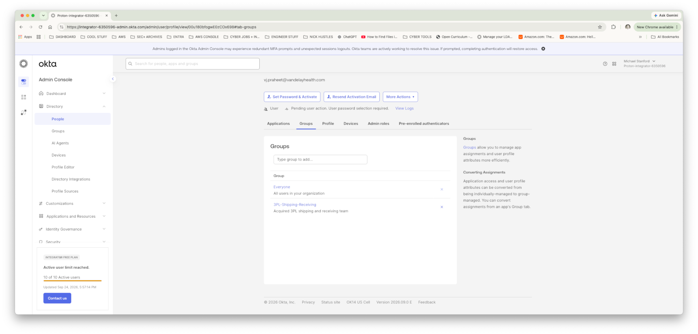
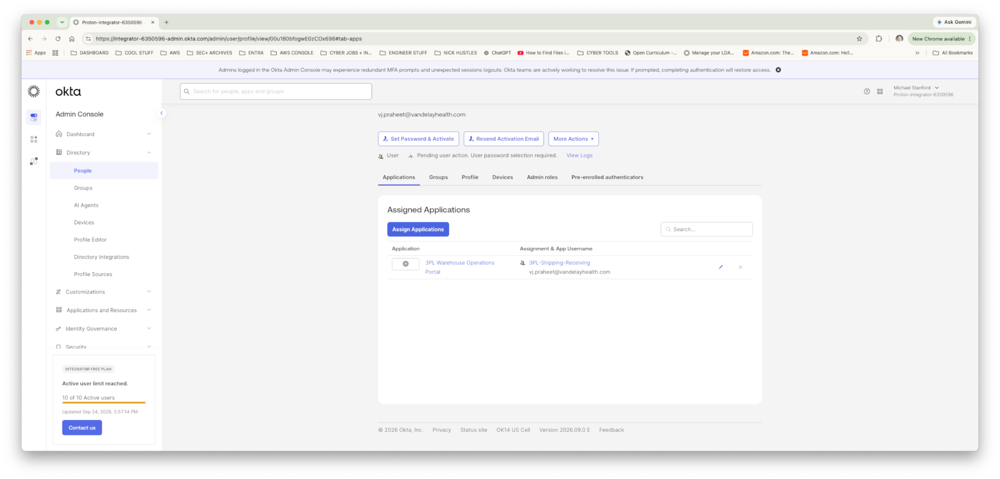
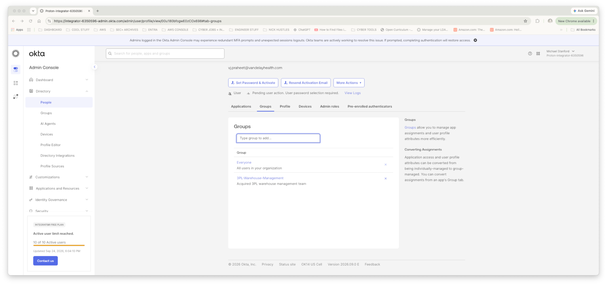
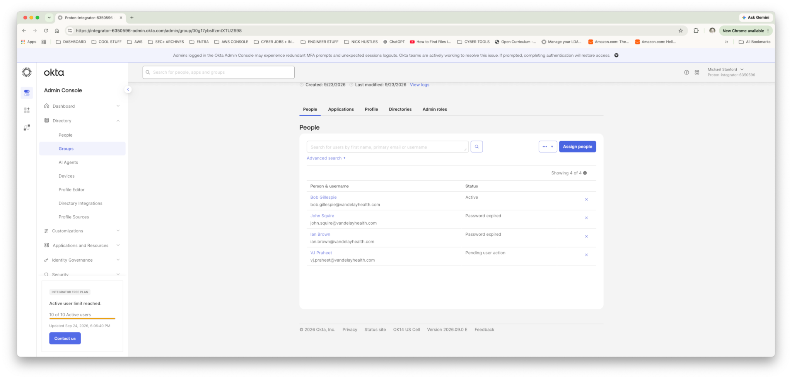
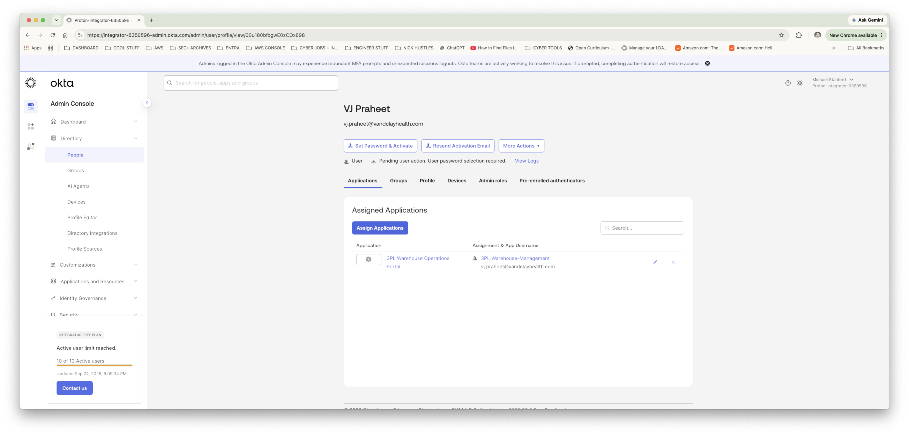
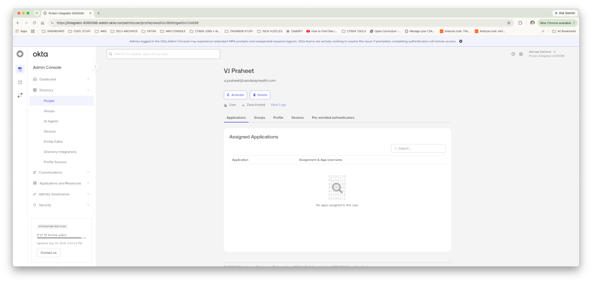

# Lab 19 — Okta Identity Lifecycle: Joiner, Mover & Leaver

## The business problem

Vandelay Health acquired a third-party logistics provider (3PL) whose warehouse workforce uses Okta. As employees join, change responsibilities, or leave, their application access needs to follow those changes.

I used **VJ Praheet's** employment lifecycle to demonstrate how business-role groups can manage access to the **3PL Warehouse Operations Portal** without assigning the application directly to an individual.

## 1. Joiner — Shipping & Receiving

VJ joined the 3PL's Shipping & Receiving team. I created his Okta workforce identity and added him to `3PL-Shipping-Receiving`.

The Warehouse Operations Portal was already assigned to that group. I checked VJ's application assignment to confirm he inherited access through **Shipping & Receiving**, rather than through a direct user assignment.

**Access path:** VJ Praheet → `3PL-Shipping-Receiving` → 3PL Warehouse Operations Portal.

## 2. Mover — Warehouse Management

VJ later transferred to Warehouse Management as executive assistant to warehouse manager **Bob Gillespie**. His responsibilities changed, so his access needed to reflect his new role—not accumulate permissions from his previous one.

I removed VJ from `3PL-Shipping-Receiving` and added him to `3PL-Warehouse-Management`.

I verified that VJ and Bob were members of the Warehouse Management group.

VJ still had access to the Warehouse Operations Portal, but **the source of that assignment had changed**. I checked the application assignment and confirmed that access now came through `3PL-Warehouse-Management`.

**Updated access path:** VJ Praheet → `3PL-Warehouse-Management` → 3PL Warehouse Operations Portal.

This is the critical mover validation: retaining access to the same application is not enough by itself. I needed to verify that VJ's access followed his **current business role**, rather than an obsolete group membership.

## 3. Leaver — Voluntary separation

VJ eventually resigned in good standing to attend the **Bagpipe Institute in Charlottetown, Prince Edward Island**.

I deactivated his Okta identity rather than deleting it. I then verified that his account showed **Deactivated**, no applications remained assigned, and the active-user count fell from **10 to 9**.

Keeping the deactivated identity allows for a possible future rehire without treating his previous permissions as automatically approved. Any return would require a new assessment of his current role and access needs.

## Outcome and lessons

I completed a Joiner–Mover–Leaver (JML) workflow in Okta and validated the resulting group memberships and application assignments at each stage.

The main lesson is that **access should reflect current business responsibilities**. Group-based assignment makes that relationship visible, but administrators still need to validate changes and remove outdated entitlements.

The screenshots establish the configured Okta state and application assignment sources; they do not establish successful interactive portal sign-ins or long-term audit-log retention.

---

## Technical reference

**Environment**
- Okta Workforce Identity — Integrator Free Plan
- Okta Universal Directory and Okta Groups
- Group-based application assignment
- 3PL Warehouse Operations Portal

**Groups used**
- `3PL-Shipping-Receiving`
- `3PL-Warehouse-Management`

**Scope:** Workforce identity creation, manual role-group membership changes, group-based application assignment verification, and account deactivation. This lab does not demonstrate automated Okta Group Rules.

**Evidence handling:** The six screenshots are included inline with the corresponding workflow steps. No passwords, recovery secrets, authentication secrets, or enrollment codes are included in the repository evidence.

**Context:** This lab builds on the Okta foundation established in Lab 18. Vandelay Health is a fictional healthcare technology company whose Ninja Sleeper product originated in a government contract and was later adapted for commercial use.
